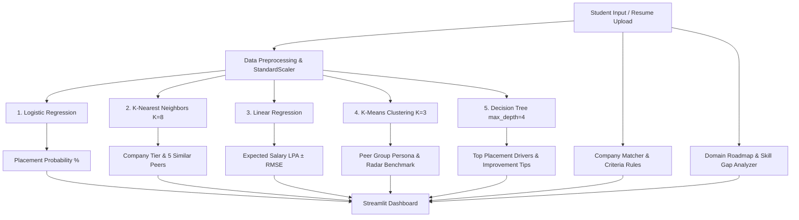

# Campus Placement Predictor & Career Guide

A machine learning project built using **Python**, **scikit-learn**, and **Streamlit**. Developed as a campus placement analytics and career guidance system to evaluate student placement probabilities, recommend company tiers, estimate salary ranges, cluster student peer profiles, and provide preparation roadmaps.

---

## Key Features

1. **Placement Probability (%):** Supervised binary classification using Logistic Regression with probabilistic outputs (`predict_proba`).
2. **Company Tier & Peer Matching:** Multi-class classification using K-Nearest Neighbors (KNN) to predict company tier fit and identify the 5 closest historical student profiles.
3. **Salary Package Estimation (LPA):** Continuous regression using Linear Regression with confidence error range ($\text{Predicted LPA} \pm \text{RMSE}$).
4. **Peer Group Clustering:** Unsupervised K-Means clustering ($K=3$) into performance groups (*Top Performers*, *Average*, *Needs Improvement*) with radar chart comparison.
5. **Feature Importance & Guidance:** Decision Tree classification (`max_depth=4`) providing transparent rule splits and prioritized recommendations.
6. **Company Eligibility Checker:** Rule-based verification of academic criteria across 25 tech recruiters, categorized into *Eligible*, *Almost Eligible*, and *Not Eligible*.
7. **Domain Preparation Roadmaps:** Step-by-step preparation guides for 7 engineering domains (`Web Dev`, `Data Science`, `AI/ML`, `Cyber Security`, `Cloud/DevOps`, `Testing/QA`, `Core Engineering`) with skill gap detection.
8. **Resume Auto-Fill:** Text parsing module (`pdfplumber` / `python-docx`) that scans candidate resumes using keyword matching to populate form parameters.
9. **Assessment Summary Download:** One-click export of student evaluation details as a `.txt` report.

---

## System Architecture



---

## Directory Structure

```
placement_project/
├── data/
│   ├── generate_dataset.py      # Generates synthetic students.csv & companies.csv
│   ├── students.csv             # 3,000 synthetic student profiles
│   └── companies.csv            # 25 campus recruiters with eligibility criteria
├── ml/
│   ├── preprocess.py            # Feature encoding, scaling, and data splits
│   ├── train_models.py          # Trains and serializes all 5 ML algorithms
│   ├── predict.py               # Unified multi-model inference functions
│   └── evaluate.py              # Evaluates models & exports diagnostic plots
├── utils/
│   ├── resume_parser.py         # Keyword & section parser for PDF/DOCX resumes
│   ├── company_matcher.py       # Rule-based eligibility and KNN tier ranker
│   └── domain_roadmap.py        # 7 tech domains with topics, tools, projects & gaps
├── models/                      # Serialized .pkl files & training metrics
├── reports/                     # Exported diagnostic evaluation charts
├── app.py                       # Streamlit frontend dashboard
├── requirements.txt             # Project library dependencies
├── README.md                    # Project documentation
└── VIVA_NOTES.md                # Examiner viva questions & concept notes
```

---

## Installation & Setup

### 1. Navigate to Project Directory
```bash
cd placement_project
```

### 2. Set Up Virtual Environment
```bash
# macOS / Linux:
python3 -m venv venv
source venv/bin/activate

# Windows:
python -m venv venv
venv\Scripts\activate
```

### 3. Install Dependencies
```bash
pip install -r requirements.txt
```

### 4. Generate Dataset (Optional - pre-generated)
```bash
python data/generate_dataset.py
```

### 5. Train Machine Learning Models
```bash
python ml/train_models.py
```

### 6. Generate Diagnostic Evaluation Plots
```bash
python ml/evaluate.py
```

### 7. Run Streamlit Application
```bash
streamlit run app.py
```
Open browser at `http://localhost:8501`.

---

## Machine Learning Models Summary

| # | Algorithm | Target Variable | Type | Primary Metric | Role in Application |
|---|---|---|---|---|---|
| 1 | **Logistic Regression** | `placed` (0 or 1) | Binary Classification | Accuracy: ~88.8%, F1: 0.91 | Placement probability calculation via `predict_proba()` |
| 2 | **K-Nearest Neighbors** | `company_tier` (1, 2, 3) | Multi-Class Classification | Optimal K=8, Test Acc: ~78.5% | Company tier prediction and retrieval of 5 closest historical records |
| 3 | **Linear Regression** | `package_lpa` | Continuous Regression | RMSE: 3.53 LPA, R²: 0.657 | Salary package estimation with ±RMSE error band |
| 4 | **K-Means Clustering** | Unsupervised | Clustering (K=3) | Silhouette: ~0.188 | Peer grouping (*Top Performers*, *Average*, *Needs Improvement*) |
| 5 | **Decision Tree** | `placed` (0 or 1) | Explainable Tree | Accuracy: ~80.8% (`max_depth=4`) | Feature importance identification and rule-based advice |

---

## Viva Voce Preparation
For a detailed guide with questions, formulas, limitations, and answers, refer to [VIVA_NOTES.md](file:///Users/krish/Desktop/placement_project/VIVA_NOTES.md).
